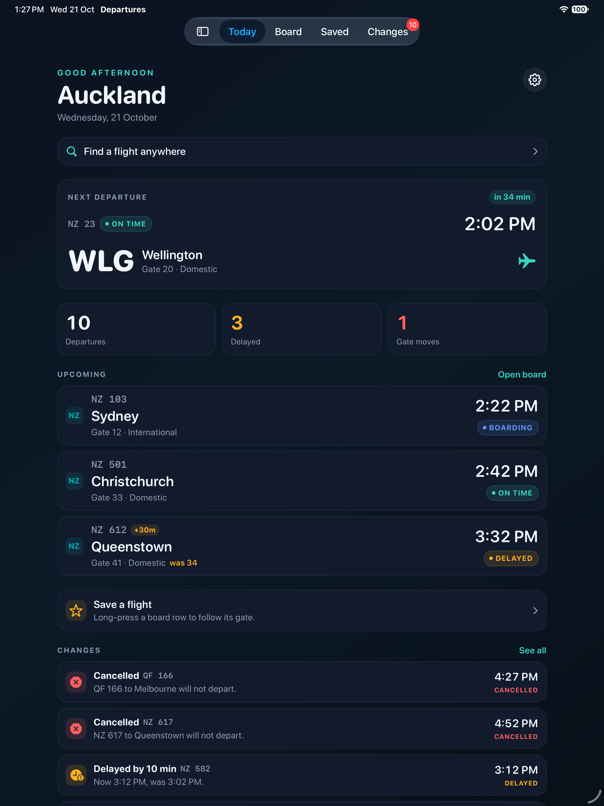
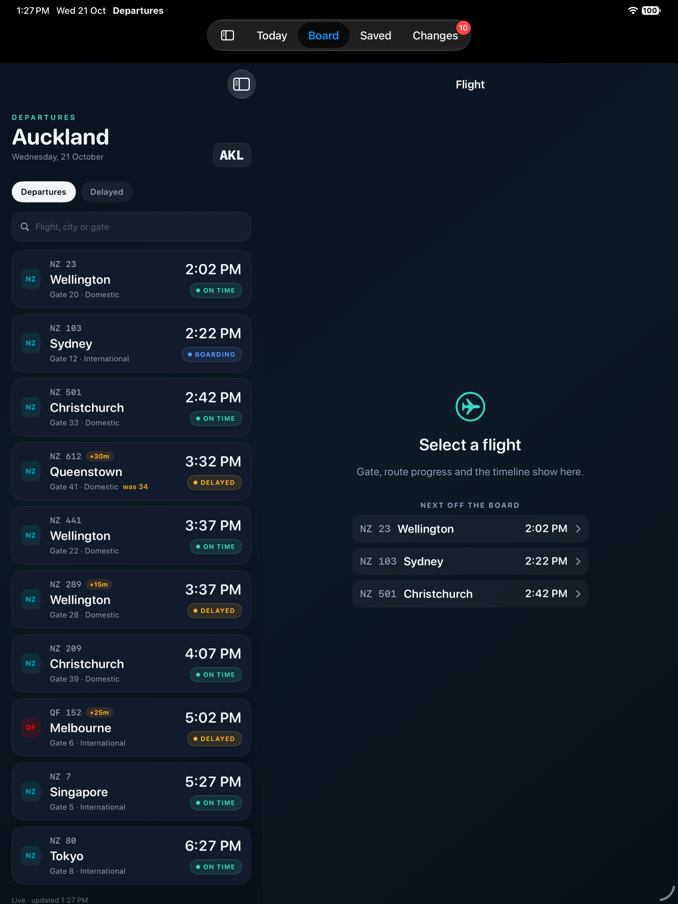
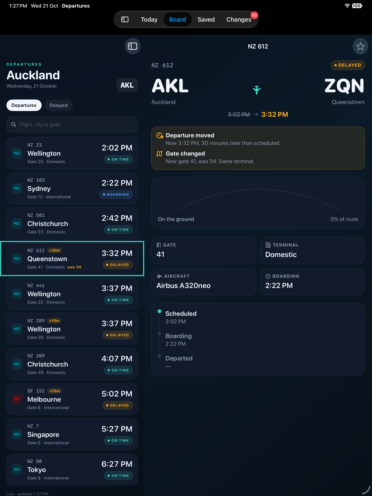
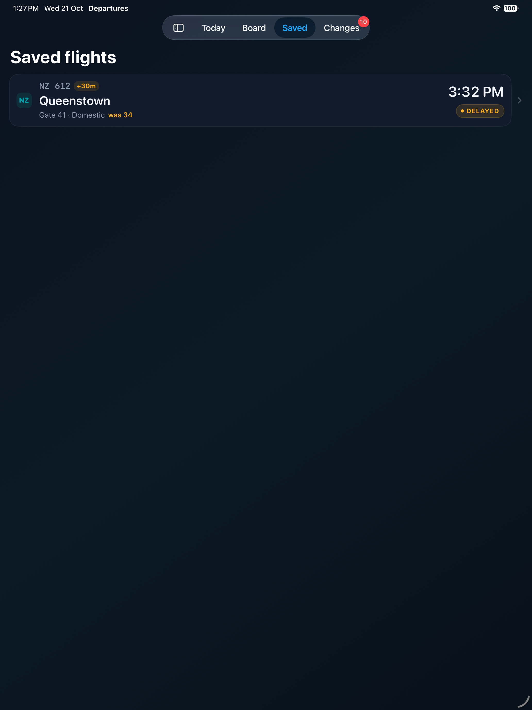
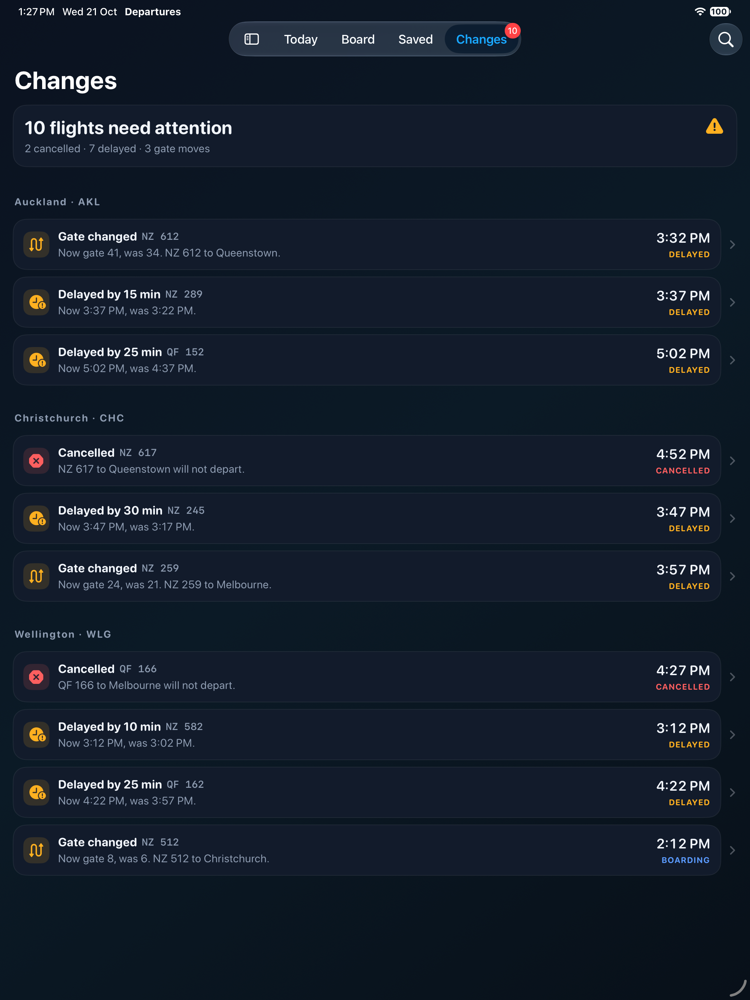
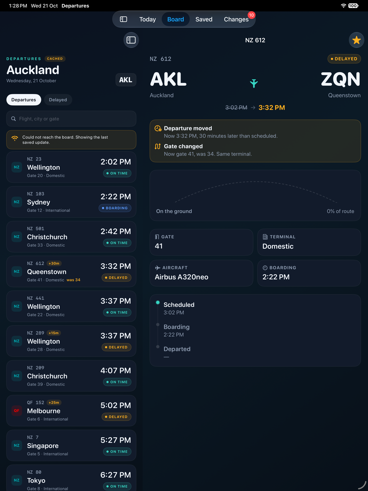
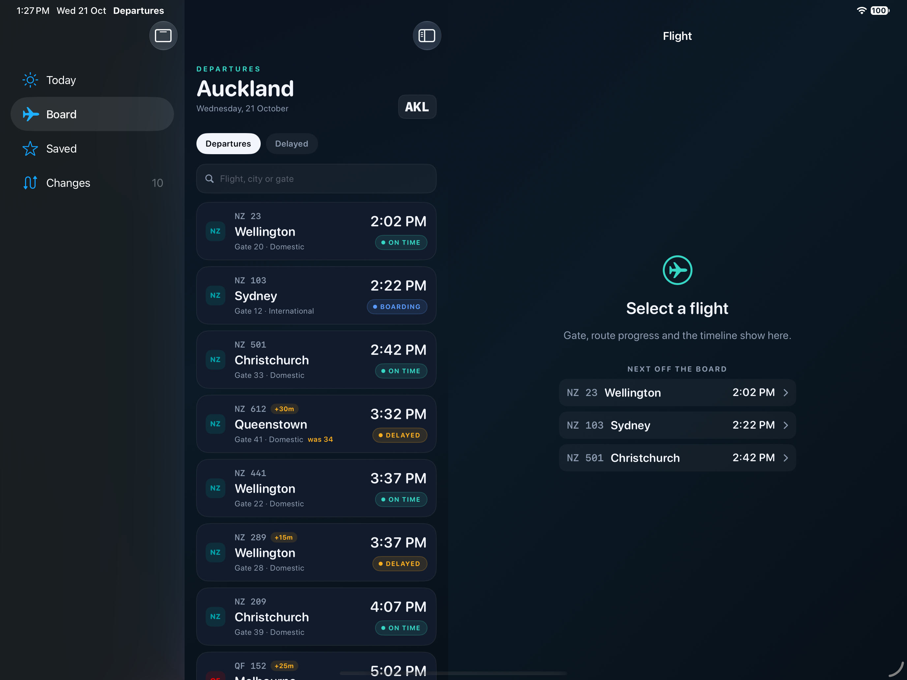

# Departures

A SwiftUI departure board for Auckland Airport, built around the parts of a travel app that usually get the least attention: the loading state, the failed request, the stale snapshot, the delayed flight, and the gate that moves while you are walking to it.

The app is small on purpose, but it is a whole app: a dashboard, a board, saved flights, a changes feed, cross-airport search, flight detail, and settings. On iPad the board and the flight detail sit side by side instead of one covering the other.

| Today | Board (iPad split) | Flight detail |
| --- | --- | --- |
|  |  |  |

| Saved | Changes | Offline, cached |
| --- | --- | --- |
|  |  |  |

<p>

<br>
<sub><b>iPad landscape.</b> The tab bar becomes a sidebar, the board keeps its own column, and the detail pane shows quick picks until a flight is selected.</sub>
</p>

## What it does

- **Today** — next departure with countdown, board stats, saved flights, and a changes preview.
- **Board** — airport switcher, search, All/Delayed filters, pull-to-refresh, optional auto-refresh.
- **Saved** — star from the board or detail; swipe to remove; survives relaunch.
- **Changes** — cancellations, gate moves, and delays in one feed, with a tab badge.
- **Search** — look up any flight across every airport, grouped by origin.
- **Flight detail** — route progress, delay and gate-change banners, gate/terminal/aircraft, timeline. Deep link: `departures://flight/NZ%20612`.
- **Offline** — the last saved snapshot, labelled **Cached** with its timestamp; never presented as live.
- **Settings** — auto-refresh, preferred airport, and demo controls for offline and gate changes.

## iPad

- Four tabs that become a sidebar in landscape, with Settings behind the gear on Today.
- At 820 points and wider, the board keeps its own column and the flight opens beside it; below that, it collapses to a stack.
- All four orientations, multitasking allowed, no forced full screen.
- Type scales up at regular width, so a 13-inch iPad does not show phone-sized labels.
- Content is capped and centred; board rows and detail tiles adapt to the column width.
- The selected airport is remembered between launches.

## Architecture

- SwiftUI with `@Observable` view models, Swift 6 language mode, strict concurrency
- `FlightRepository` protocol in front of the data source, so the view model has no idea whether data comes from a network or a stub
- `DemoFlightService` is an actor with an artificial 450 ms delay, a disk snapshot, and explicit demo controls for offline and gate changes
- One service instance is shared by the whole app, so Settings acts on the board the traveller is looking at
- `Router` owns tab selection so dashboard actions can hand off to the right section
- Delay in minutes, status labels, route progress, attention count, and change summaries are derived from the model rather than stored, so a stale snapshot cannot claim an aircraft is further along than it is
- No third-party dependencies

```
Departures/
  App/            entry point
  Domain/         Flight, Airport, Airline, FlightStatus
  Data/           FlightRepository, DemoFlightService (actor, disk snapshot)
  Design/         palette, gradients, card surface
  Components/     StatusPill, AirlineMark, BoardRow, SavedFlightCard, ChangeRow, FlightArc
  Features/
    Root/         RootView, Router
    Today/        TodayView
    Board/        BoardView, BoardListView, BoardViewModel
    Detail/       FlightDetailView, FlightDetailPlaceholder
    Search/       FlightSearchView
    Airports/     AirportsView
    Saved/        SavedFlights, SavedFlightsView
    Changes/      ChangesView
    Settings/     SettingsView
DeparturesTests/  Swift Testing suites
DeparturesUITests/ end-to-end flows on iPhone and iPad
```

## Running it

Requires Xcode 16 or later and [XcodeGen](https://github.com/yonaskolb/XcodeGen).

```sh
brew install xcodegen
xcodegen generate
open Departures.xcodeproj
```

Tests, iPhone:

```sh
xcodebuild test \
  -project Departures.xcodeproj \
  -scheme Departures \
  -destination 'platform=iOS Simulator,name=iPhone 16'
```

Tests, iPad:

```sh
xcodebuild test \
  -project Departures.xcodeproj \
  -scheme Departures \
  -destination 'platform=iOS Simulator,name=iPad Pro 13-inch (M4)'
```

## Tests

Eleven unit tests cover:

- filter behaviour, including cancelled flights under "Delayed"
- search across flight number, city, and gate, case-insensitively
- whitespace-only search not filtering the board
- repository failure surfacing a message while leaving the board usable
- failure falling back to the cached snapshot and keeping its original timestamp
- gate change detection on the model
- delay arithmetic and route progress

Three UI tests walk the app end to end: Today, the airport picker, a flight detail, starring and the Saved list, the Changes feed, the Settings demo controls, the offline fallback with its cached badge, cross-airport search, rotation, and the `departures://flight/NZ%20612` deep link.

The suite was run on iPhone 17 Pro and on every iPad width the layout branches on:

| Device | Width | Layout |
| --- | --- | --- |
| iPad Pro 13-inch | 1032 pt | split |
| iPad Air 11-inch | 834 pt | split |
| iPad (A16) | 820 pt | split |
| iPad mini (A17 Pro) | 744 pt | stack |
| iPhone 17 Pro | 402 pt | stack |

## Decisions

**Progress is computed, not stored.** A cached flight is a claim about the past. Deriving progress from the schedule means the worst case is an out-of-date percentage, not a false one.

**Stale data says so.** The offline snapshot is useful, but only if the UI admits what it is. The header switches to a "Cached" badge and the footer keeps the timestamp.

**One board, two layouts.** `NavigationSplitView` at 820 points and wider, and a stack below it, share the same `BoardListView`, so iPad does not get a separate feature branch of the board. The width check also handles iPad multitasking columns without a second size-class rule.

**Selection is an ID, not a snapshot.** The split view remembers the flight's identifier, and the detail column re-resolves it from the latest board. A gate change that lands while the detail is open shows up without re-tapping.

**Attention is derived.** The badge, the Changes feed, and the dashboard stats all read the same computed list, so they cannot disagree.

**Deep links are routed at the app root.** The URL is parsed once, then handed to the board through the router. Handling it inside the Board tab meant a link opened while Today was showing did nothing, because the board never received the event.

**No dependency injection framework.** One protocol and one initialiser parameter. The tests inject a stub in three lines.

**Screenshots come from the UI test run.** The flow test attaches a capture at each screen, and the DEBUG hooks (`OPEN_TAB`, `OPEN_FLIGHT`) open a screen or flight directly for manual captures. Both are compiled out of release builds.

## Limitations

- Demo data only. There is no live API, and the flight list is fixed apart from relative times.
- The gate change is fixed to one fixture and triggered from Settings. There is no live push notification.
- No app icon, localisation, or accessibility audit beyond labels on the board and change rows.
