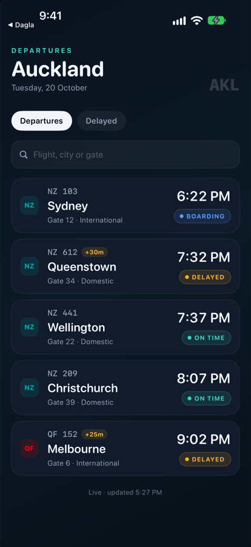
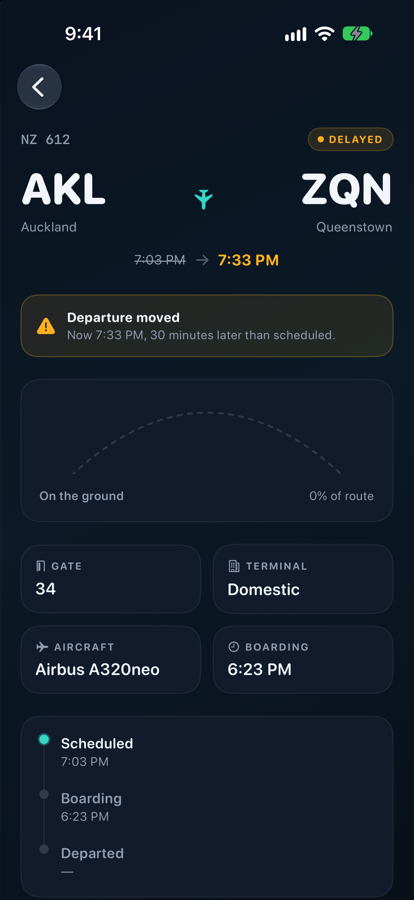
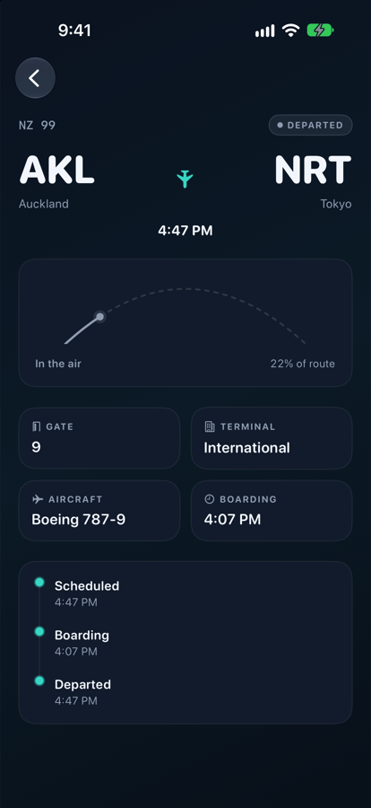

# Departures

A SwiftUI departure board for Auckland Airport. I built it around the part of a mobile app that usually gets the least attention: the loading state, the failed request, the stale snapshot, the delayed flight, and the gate that moves while you are walking to it.

| Board | Delayed flight | In the air |
| --- | --- | --- |
|  |  |  |

## What it does

- Departure board with search by flight number, city, or gate
- Filters for all departures or delayed flights only
- Flight detail with route progress, gate, terminal, aircraft, boarding time, and a three-step timeline
- Delayed flights keep the scheduled time visible, struck through, next to the new one
- Cached data is labelled "Cached" with the time it was saved. The app never presents old data as live
- Deep link: `departures://flight/NZ%20612`

## Architecture

- SwiftUI with `@Observable` view models, Swift 6 language mode, strict concurrency
- `FlightRepository` protocol in front of the data source, so the view model has no idea whether data comes from a network or a stub
- `DemoFlightService` is an actor with an artificial 450 ms delay, and writes a JSON snapshot to the caches directory
- Delay in minutes, status labels, and route progress are derived from the model rather than stored, so a stale snapshot cannot claim an aircraft is further along than it is
- No third-party dependencies

```
Departures/
  App/            entry point
  Domain/         Flight, Airport, Airline, FlightStatus
  Data/           FlightRepository, DemoFlightService (actor, disk snapshot)
  Design/         palette, gradients, card surface
  Components/     StatusPill, AirlineMark, BoardRow, FlightArc
  Features/
    Board/        BoardView, BoardViewModel
    Detail/       FlightDetailView
DeparturesTests/  Swift Testing suites
```

## Running it

Requires Xcode 16 or later and [XcodeGen](https://github.com/yonaskolb/XcodeGen).

```sh
brew install xcodegen
xcodegen generate
open Departures.xcodeproj
```

Tests:

```sh
xcodebuild test \
  -project Departures.xcodeproj \
  -scheme Departures \
  -destination 'platform=iOS Simulator,name=iPhone 16'
```

## Tests

Nine tests in two suites, covering:

- filter behaviour, including cancelled flights under "Delayed"
- search across flight number, city, and gate, case-insensitively
- whitespace-only search not filtering the board
- repository failure surfacing a message while leaving the board usable
- delay arithmetic and route progress

## Decisions

**Progress is computed, not stored.** A cached flight is a claim about the past. Deriving progress from the schedule means the worst case is an out-of-date percentage, not a false one.

**Stale data says so.** The offline snapshot is useful, but only if the UI admits what it is. The footer switches from "Live" to "Cached" and keeps the timestamp.

**No dependency injection framework.** One protocol and one initialiser parameter. The tests inject a stub in three lines.

**Screenshots come from a DEBUG launch hook.** `OPEN_FLIGHT` opens a flight directly so captures do not depend on tapping coordinates. It is compiled out of release builds.

## Limitations

- Demo data only. There is no live API, and the flight list is fixed apart from relative times.
- The gate-change simulation exists in `DemoFlightService` but is not wired to a control in the UI.
- No app icon, localisation, or accessibility audit beyond labels on the board rows.
